# Argo DidUP Booster

Estensione per **Google Chrome** pensata per i docenti che usano il registro elettronico **Argo DidUP**. Con un clic:

- **Accesso automatico.** L'estensione compila il codice scuola, sceglie SPID (con il tuo provider) o CIE e ti porta all'autenticazione. A te resta solo confermare con l'app del provider o con la CIE.
- **Firma ora.** Trova la lezione da firmare leggendo gli orari dalla pagina e la firma. Se l'ora non è in corso, prima ti chiede il permesso.
- **Appello.** Apre l'appello della lezione più vicina all'ora attuale, da qualsiasi schermata del registro.
- **Argomenti e compiti.** Mentre modifichi una lezione, inserisci con un clic gli argomenti (in *Attività svolta*) e i compiti (in *Compiti*) che hai preparato per ogni disciplina.
- **Mantenimento della sessione.** La sessione non scade mentre il registro è aperto.

> Progetto indipendente e **non ufficiale**: non è collegato in alcun modo ad Argo Software né al Ministero dell'Istruzione e del Merito. Controlla sempre nel registro che firme e appelli siano corretti.

---

## Indice

1. [Requisiti](#requisiti)
2. [Installazione](#installazione)
3. [Prima configurazione](#prima-configurazione)
4. [Uso quotidiano](#uso-quotidiano)
5. [Guida alle funzionalità](#guida-alle-funzionalità)
6. [Aggiornare l'estensione](#aggiornare-lestensione)
7. [Problemi frequenti](#problemi-frequenti)
8. [Privacy e permessi](#privacy-e-permessi)
9. [Per chi sviluppa](#per-chi-sviluppa)

---

## Requisiti

- **Google Chrome** per computer (Windows, macOS o Linux), aggiornato. Va bene anche un browser basato su Chromium, come Edge o Brave, ma l'estensione è provata su Chrome.
- Un account **docente** su Argo DidUP e un'identità **SPID** o la **CIE**.
- Il **codice scuola** di Argo, quello che inserisci nella pagina di accesso (es. `SG12345`).

## Installazione

L'estensione non è sul Chrome Web Store: si installa da una cartella, come "estensione non pacchettizzata". Bastano pochi minuti.

1. **Copia la cartella** `ArgoDidUP-Extension` sul computer, in una posizione dove resterà (es. *Documenti*). Se l'hai ricevuta come file `.zip`, estraila prima. **Non cancellarla dopo l'installazione**: Chrome legge i file direttamente da lì.
2. Apri Chrome e scrivi nella barra degli indirizzi: `chrome://extensions`
3. In alto a destra attiva **Modalità sviluppatore**.
4. Premi **Carica estensione non pacchettizzata** e seleziona la cartella `ArgoDidUP-Extension`, cioè quella che contiene il file `manifest.json`.
5. Fissa l'icona nella barra: premi l'icona a forma di **puzzle** in alto a destra, poi la **puntina** accanto ad *Argo DidUP Booster*.
6. Si apre da sola la pagina delle **Impostazioni**: continua con la [prima configurazione](#prima-configurazione).

> **Nota.** Lascia attiva la *Modalità sviluppatore*: Chrome la richiede per le estensioni installate da una cartella. Può capitare che mostri un avviso sulle estensioni in modalità sviluppatore: è normale.

## Prima configurazione

Le impostazioni si aprono dall'ingranaggio nel popup oppure con il **tasto destro sull'icona → Opzioni**. Ogni modifica viene salvata subito.

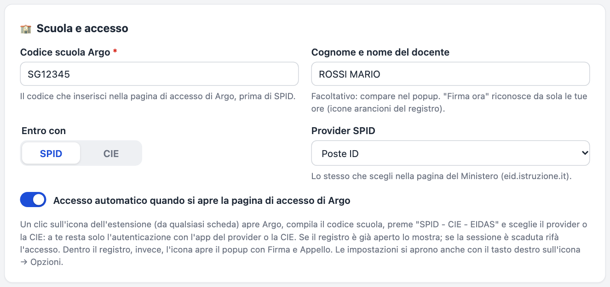

1. **Codice scuola Argo**: obbligatorio. Finché manca, l'icona mostra un punto esclamativo rosso.
2. **Entro con**: *SPID* oppure *CIE*.
3. **Provider SPID**: lo stesso che scegli nella pagina del Ministero (Poste ID, Aruba ID, InfoCert ID, …). Con *"Scelgo ogni volta"* l'estensione apre l'elenco dei provider e lascia scegliere a te.
4. **Accesso automatico**: con l'opzione attiva l'accesso parte appena si apre la pagina di accesso di Argo. Con l'opzione spenta parte solo quando premi l'icona.
5. **Cognome e nome** (facoltativo): compare nel popup.

## Uso quotidiano

- **Per entrare nel registro**, premi l'icona dell'estensione da qualsiasi scheda. Si apre Argo, l'estensione fa tutti i passaggi e tu confermi l'accesso sull'app del provider (o con la CIE). Se il registro è già aperto, l'estensione ti porta a quella scheda; se la sessione è scaduta, rifà l'accesso.
- **Dentro il registro**, la stessa icona apre il popup con **Firma ora** e **Appello**:

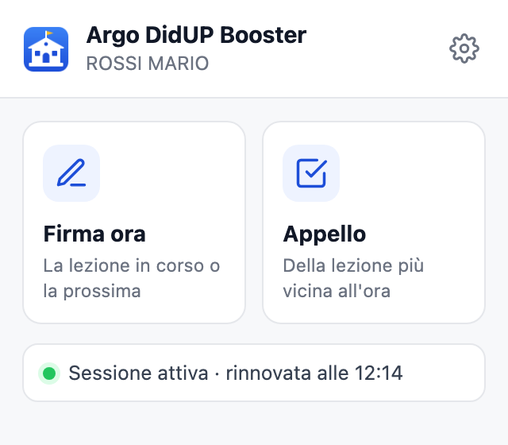

La riga in basso indica se la sessione viene mantenuta attiva. Quando la sessione è scaduta, compare il pulsante **Accedi di nuovo**.

## Guida alle funzionalità

### Accesso automatico con SPID o CIE

Quando premi l'icona fuori dal registro, l'estensione:

1. apre `https://www.portaleargo.it/voti/`;
2. nella pagina di Argo inserisce il **codice scuola** e preme **SPID - CIE - EIDAS**;
3. nella pagina del Ministero (`eid.istruzione.it`) sceglie il **tuo provider SPID** oppure **Entra con CIE**;
4. se dopo SPID hai **più profili Argo**, sceglie quello del tuo codice scuola.

A te resta l'autenticazione sull'app del provider o con la CIE.

Se l'accesso non va a buon fine o lo annulli, per 90 secondi l'estensione non riparte da sola, per non ripetere i tentativi all'infinito. In quel caso compare un avviso con il pulsante **Riprova**.

### Firma ora

Dal popup, da qualsiasi schermata del registro, **Firma ora**:

1. clicca **Home** nel menu a sinistra e legge le tue lezioni di oggi;
2. legge gli **orari** dalla pagina: dai dati della Home oppure, se lì mancano, dalla tabella del registro di classe (es. *08:00 - 09:00*);
3. sceglie la lezione **in corso**. Se non c'è, sceglie la **prossima più vicina**; se non ce ne sono più, l'**ultima passata non ancora firmata**;
4. entra nel registro di quella classe e clicca l'icona arancione **"da firmare"**. Firma anche le altre tue ore consecutive nella stessa classe (es. 2ª e 3ª ora).

**Quando ti chiede il permesso.** Se la fascia oraria dell'ora da firmare **contiene l'ora attuale**, la firma subito. Altrimenti, per esempio per la prossima lezione mentre sei in intervallo, ti chiede prima se procedere:

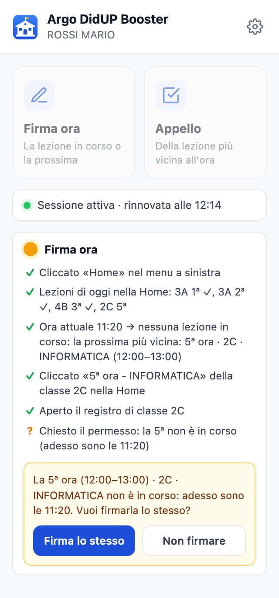

- Con **Firma lo stesso** la firma viene fatta.
- Con **Non firmare** l'estensione non tocca nulla.
- Se in un blocco di ore consecutive solo una è in corso, puoi scegliere di firmare solo quella.
- Se chiudi il popup, la domanda compare in basso a destra nella pagina del registro.

**Cosa non fa mai:**
- non clicca mai su un'ora **già firmata**, perché in DidUP quel clic serve a togliere la firma;
- se stai modificando una lezione, non clicca *Home*, così non perdi il testo che stai scrivendo.

Il popup mostra passo per passo cosa ha cliccato e perché ha scelto quella lezione:

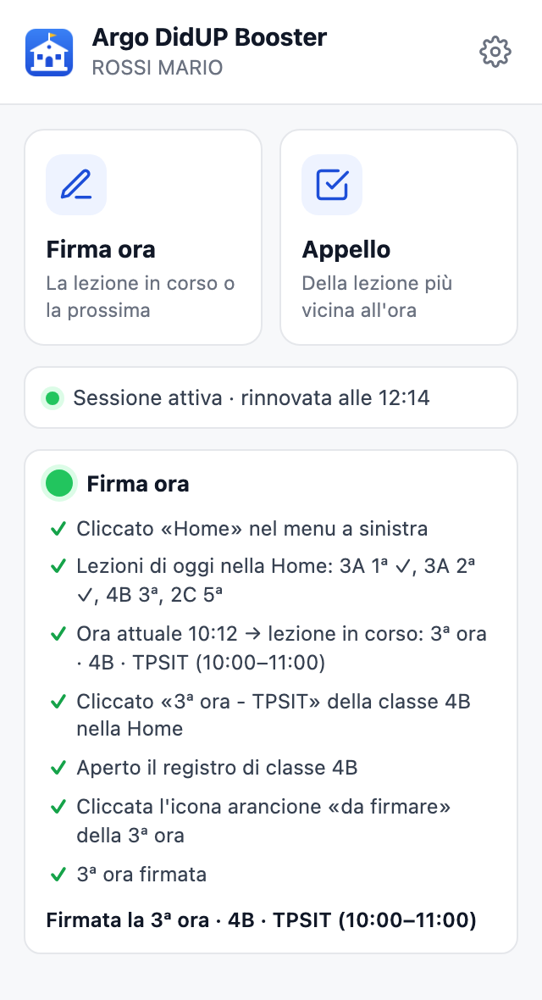

### Appello

**Appello** clicca *Home* e sceglie la lezione più coerente con l'ora attuale. Per primo cerca quella **in corso**. Se non c'è, prende quella che **inizia entro 15 minuti**, poi quella **appena finita**, infine la prossima. Poi entra nel registro di quella classe e apre l'appello.

DidUP attiva il pulsante *Appello* solo quando l'ora è firmata da te, a meno che tu sia coordinatore o docente della classe. Se il pulsante è disattivato, l'estensione lo spiega:

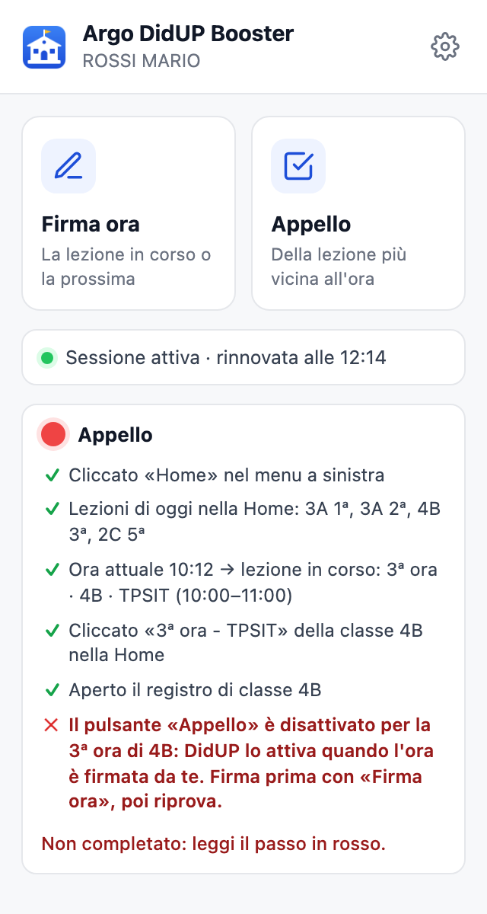

Quando qualcosa non va, il passo in **rosso** dice esattamente cosa è stato cliccato e cosa non è stato trovato. Copialo se devi chiedere aiuto.

### Argomenti e compiti

Nelle **Impostazioni → Discipline, argomenti e compiti** crei le tue discipline. Per ognuna ci sono due elenchi separati, ciascuno nella sua scheda:
- **Argomenti**: quello che fai a lezione, va in *Attività svolta*;
- **Compiti**: quello che assegni, va in *Compiti*.

Sotto il nome di ogni disciplina vedi quante voci ha, per esempio *4 argomenti · 3 compiti*. Entrambi gli elenchi funzionano allo stesso modo:
- trascina la maniglia ⠿ o usa le frecce per ordinare le voci;
- fai doppio clic su una voce per modificarla;
- **Ordina A→Z** le mette in ordine alfabetico;
- puoi incollare più voci insieme, una per riga.

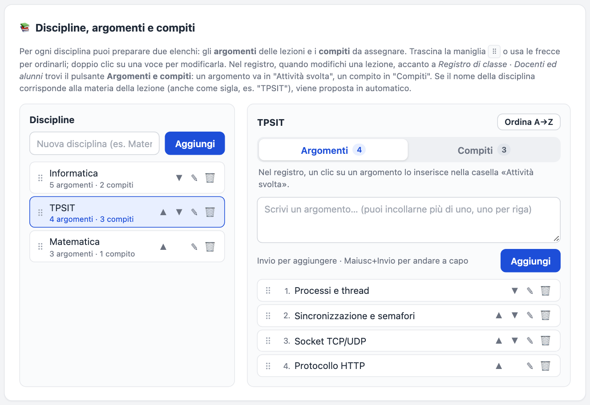

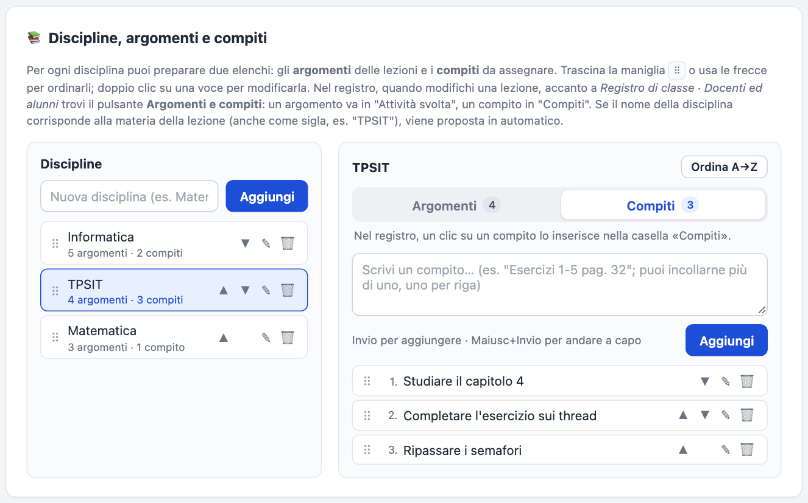

Nel registro, quando **modifichi una lezione**, accanto a *Registro di classe · Docenti ed alunni* compare il pulsante **Argomenti e compiti**. Nel pannello scegli la disciplina; sotto ci sono le schede **Argomenti** e **Compiti**, con il numero di voci:
- un clic su un **argomento** lo inserisce in **Attività svolta**;
- un clic su un **compito** lo inserisce in **Compiti**, nella scheda dei compiti aperta.

In entrambi i casi va a capo come fa il pulsante "Argomenti" di Argo, e il testo viene salvato come se l'avessi scritto tu.

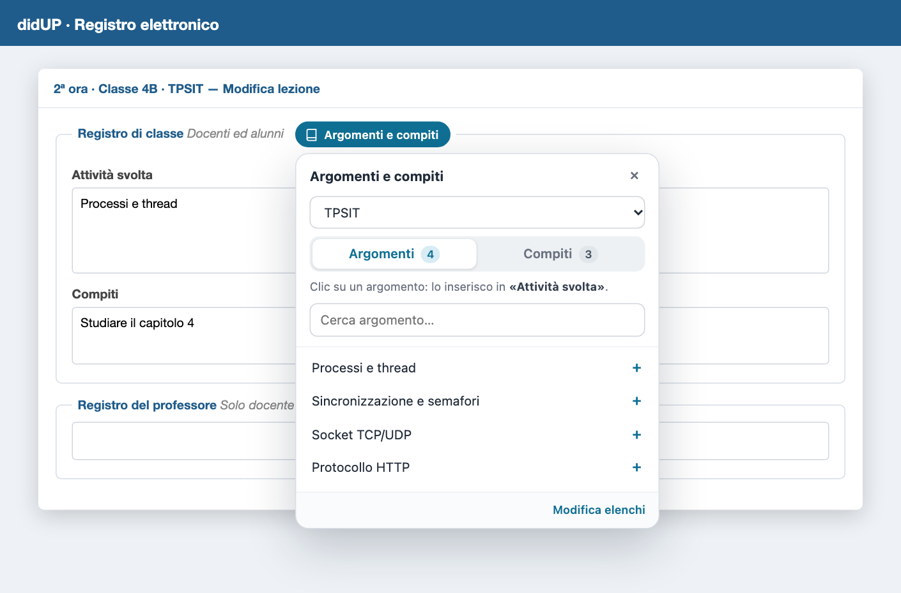

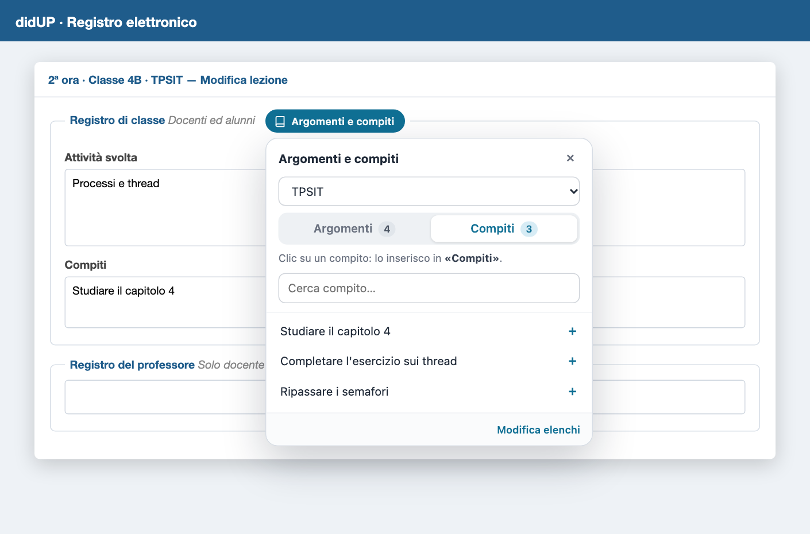

- **Disciplina proposta.** Viene scelta in base alla materia della lezione, anche se l'hai chiamata con una sigla (es. *TPSIT*). Il pannello si riapre sull'ultima scheda che hai usato.
- **Ricerca.** Il campo *Cerca* filtra l'elenco; con *Invio* inserisce il primo risultato.
- **Limite di 500 caratteri.** Se la voce farebbe superare il limite di DidUP, oppure se la casella è bloccata, viene copiata negli appunti e ti viene detto perché.

### Mantenimento della sessione

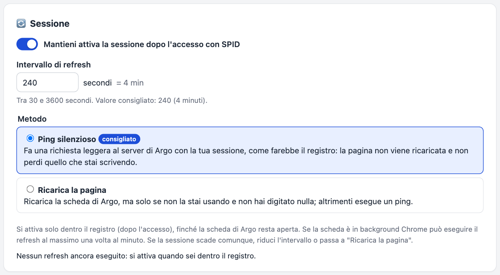

Mentre il registro è aperto, l'estensione fa ogni tanto una richiesta leggera e di sola lettura al server di Argo, con le stesse credenziali del registro, così la sessione non scade. Puoi scegliere l'intervallo, tra 30 e 3600 secondi; il consigliato è 240. In alternativa puoi scegliere **Ricarica la pagina**: ricarica la pagina solo se non la stai usando e non hai scritto nulla.

### Esporta / importa

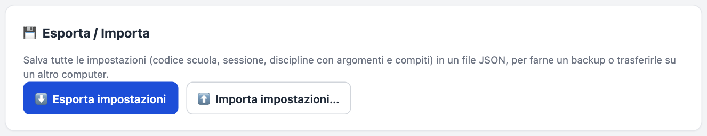

**Esporta impostazioni** salva tutto in un file `.json`: codice scuola, accesso, sessione, discipline con argomenti e compiti. Ti serve per fare un backup o per passare le impostazioni su un altro computer. Quando **importi**, puoi scegliere se **sostituire** tutto oppure solo **aggiungere** argomenti e compiti a quelli che hai già.

## Versione e informazioni

In fondo alle **Impostazioni**, la sezione **Informazioni** riporta nome, **versione**, **commit** e **data del commit** della copia installata. Servono quando chiedi aiuto o devi controllare di avere l'ultima versione.

## Aggiornare l'estensione

1. Sostituisci i file nella **stessa cartella** usata per l'installazione, con la nuova versione.
2. Premi l'icona dell'estensione oppure apri il popup o le Impostazioni. L'estensione si accorge che i file sono cambiati e **si ricarica da sola**, poi prosegue con quello che stavi facendo. Il popup, se era aperto, si chiude un attimo: riaprilo.
3. Se non succede, vai su `chrome://extensions` e premi **Ricarica** (la freccia circolare) su *Argo DidUP Booster*.

## Problemi frequenti

| Problema | Cosa fare |
|---|---|
| Al clic sull'icona non succede nulla | Vai su `chrome://extensions` e premi **Ricarica** sull'estensione. Controlla che la *Modalità sviluppatore* sia attiva. |
| Si aprono le Impostazioni invece di Argo | Manca il **codice scuola**: inseriscilo. |
| Nella pagina del Ministero non viene scelto il provider | Controlla di aver scelto il **Provider SPID** nelle Impostazioni. Con *"Scelgo ogni volta"* l'elenco viene aperto e scegli tu. |
| «Accesso automatico in pausa» | L'ultimo tentativo non è andato a buon fine: premi **Riprova** o l'icona. |
| *Firma ora* ha scelto un'ora che non è in corso | Ti chiede sempre conferma: rispondi **Non firmare** se non è quella giusta. Controlla anche che l'ora del computer sia corretta. |
| «Il pulsante Appello è disattivato» | In DidUP l'appello si apre dopo aver firmato l'ora: usa prima **Firma ora**. |
| La sessione scade lo stesso | Riduci l'intervallo nelle Impostazioni o scegli **Ricarica la pagina**. Tieni aperta la scheda del registro. |
| Il pulsante «Argomenti e compiti» non compare | Compare solo nella schermata di **modifica** di una lezione, accanto a *Registro di classe · Docenti ed alunni*. |
| Un passo in rosso nel popup | Leggi cosa non è stato trovato e controlla di essere nel registro DidUP. Se DidUP è cambiato, segnala il messaggio. |

## Privacy e permessi

- **Dove restano i dati.** Impostazioni, discipline, argomenti e compiti restano **solo nel tuo browser** (memoria locale di Chrome). L'estensione non usa server propri e non invia dati a terzi.
- **Niente password.** L'estensione **non legge e non salva** password o credenziali SPID/CIE: l'autenticazione la fai sempre tu sull'app del provider o con la CIE.
- **Su quali siti lavora.** Agisce solo su `portaleargo.it` e su `eid.istruzione.it` (la pagina di accesso del Ministero).
- **Permessi richiesti:**
  - `storage` per salvare le impostazioni;
  - `scripting` e `activeTab` per Firma e Appello nella scheda del registro;
  - `clipboardWrite` per copiare un argomento o un compito negli appunti quando non può essere inserito.

## Per chi sviluppa

- **Struttura e funzionamento.** Sono descritti in [`CLAUDE.md`](CLAUDE.md).
- **Test.** Servono Node.js 20+ e Google Chrome. Si lanciano con `node tests/run-all.mjs`; con `--reali` provano anche l'accesso sulle pagine vere di Argo e del Ministero, fermandosi alla pagina del provider e senza credenziali.
- **Immagini di questa guida.** Si rigenerano con `node tests/screenshots.mjs`.
- **Versione.** A ogni modifica aumenta `version` in `manifest.json` (numerazione `MAJOR.MINOR.PATCH`, partita da 1.0.0): è così che l'estensione già installata si accorge dell'aggiornamento e si ricarica.
- **Commit nella sezione Informazioni.** `node tools/build-info.mjs` scrive `build-info.json` con commit e data. Con `git config core.hooksPath tools/git-hooks` lo fa da solo dopo ogni commit, checkout, merge e rebase.
- **Cartelle `tests/` e `tools/`.** Non servono all'estensione e possono essere escluse quando la distribuisci.
