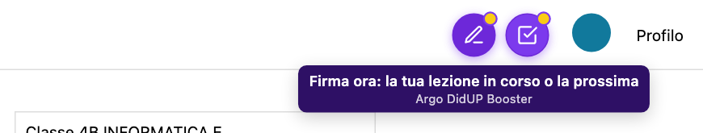
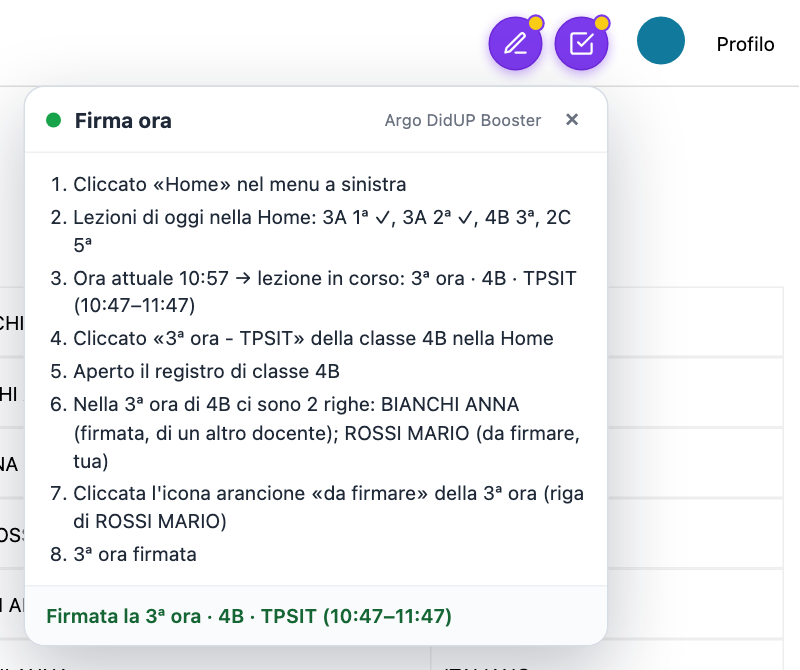
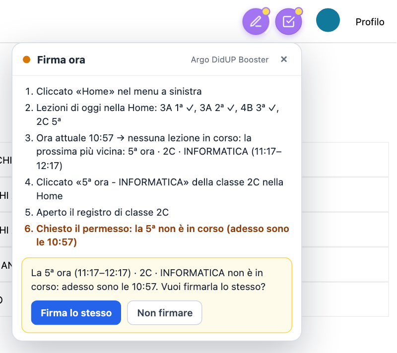
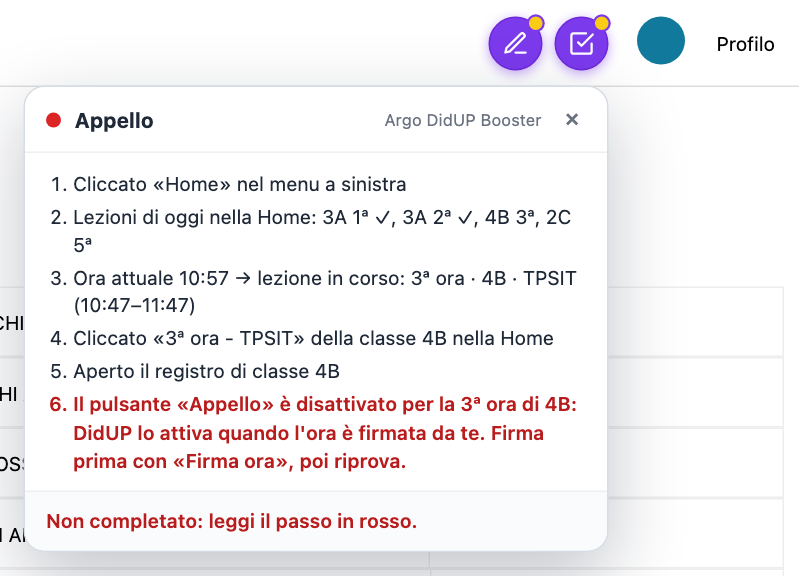
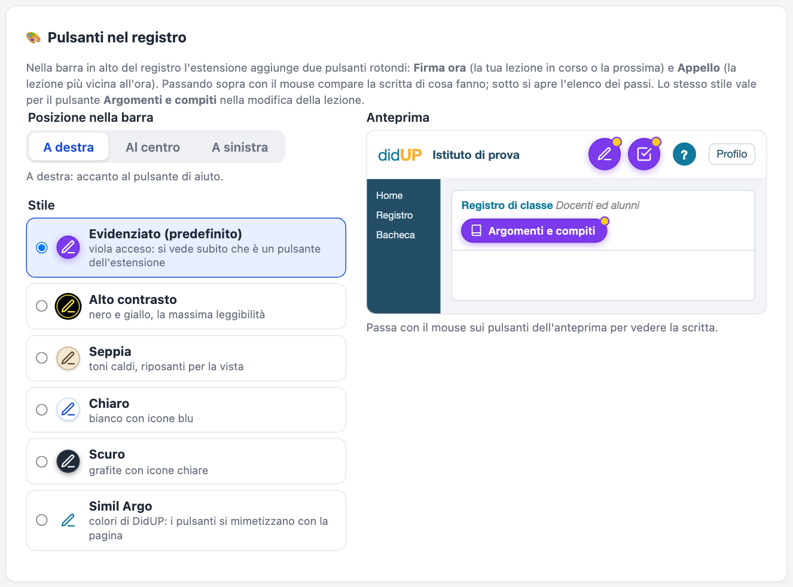

# Argo DidUP Booster

Estensione per **Google Chrome** pensata per i docenti che usano il registro elettronico **Argo DidUP**. Con un clic:

- **Accesso automatico.** L'estensione compila il codice scuola, sceglie SPID (con il tuo provider) o CIE e ti porta all'autenticazione. A te resta solo confermare con l'app del provider o con la CIE.
- **Firma ora.** Un pulsante nella barra del registro trova la tua lezione leggendo gli orari dalla pagina e la firma. Nelle classi articolate e in compresenza firma la **tua** riga, non quella del collega. Se l'ora non è in corso, prima ti chiede il permesso.
- **Appello.** Un pulsante nella barra del registro apre l'appello della lezione più vicina all'ora attuale, da qualsiasi schermata.
- **Argomenti e compiti.** Mentre modifichi una lezione, inserisci con un clic gli argomenti (in *Attività svolta*) e i compiti (in *Compiti*) che hai preparato per ogni disciplina.
- **Mantenimento della sessione.** La sessione non scade mentre il registro è aperto, anche se la scheda è in secondo piano.

> Progetto indipendente e **non ufficiale**: non è collegato in alcun modo ad Argo Software né al Ministero dell'Istruzione e del Merito. Controlla sempre nel registro che firme e appelli siano corretti.

---

## Indice

1. [Requisiti](#requisiti)
2. [Installazione](#installazione)
3. [Prima configurazione](#prima-configurazione)
4. [Uso quotidiano](#uso-quotidiano)
5. [Guida alle funzionalità](#guida-alle-funzionalità)
6. [Aggiornare l'estensione](#aggiornare-lestensione)
7. [Problemi frequenti](#problemi-frequenti)
8. [Privacy e permessi](#privacy-e-permessi)
9. [Per chi sviluppa](#per-chi-sviluppa)

---

## Requisiti

- **Google Chrome** per computer (Windows, macOS o Linux), aggiornato. Va bene anche un browser basato su Chromium, come Edge o Brave, ma l'estensione è provata su Chrome.
- Un account **docente** su Argo DidUP e un'identità **SPID** o la **CIE**.
- Il **codice scuola** di Argo, quello che inserisci nella pagina di accesso (es. `SG12345`).

## Installazione

L'estensione non è sul Chrome Web Store: si installa da una cartella, come "estensione non pacchettizzata". Bastano pochi minuti.

1. **Scarica l'ultima versione.** Apri la pagina dell'[**ultima release**](https://github.com/madxit/argo_didup_booster/releases/latest) e, sotto *Assets*, premi **Source code (zip)**. Se la pagina è vuota, scegli la versione più recente dall'[elenco dei tag](https://github.com/madxit/argo_didup_booster/tags) e premi **zip**.
2. **Estrai il file zip** (doppio clic su Mac; su Windows tasto destro → *Estrai tutto*). Ottieni una cartella `argo_didup_booster-Release-X.Y.Z`, dove `X.Y.Z` è la versione.
3. **Sposta la cartella in una posizione che non cambierà nel tempo** e **non cancellarla dopo l'installazione**: Chrome legge i file direttamente da lì. Se la sposti o la rinomini, Chrome la considera un'estensione nuova e le impostazioni ripartono da zero. Consiglio:
   - crea una cartella **`Estensioni Chrome`** nella tua cartella personale: su Mac è quella con la casetta (nel Finder: *Vai → Inizio*), su Windows `C:\Users\<tuo nome>\`;
   - mettici dentro la cartella estratta e **rinominala** `argo_didup_booster`, senza il numero di versione: così gli aggiornamenti andranno sempre nella stessa cartella;
   - evita *Download*, *Scrivania* e le cartelle sincronizzate (iCloud, OneDrive, Google Drive): vengono svuotate o spostate più facilmente. Su Windows evita anche *Programmi*, che richiede i permessi di amministratore.
4. Apri Chrome e scrivi nella barra degli indirizzi: `chrome://extensions`
5. In alto a destra attiva **Modalità sviluppatore**.
6. Premi **Carica estensione non pacchettizzata** e seleziona la cartella `argo_didup_booster` del passo 3, cioè quella che contiene il file `manifest.json`.
7. Fissa l'icona nella barra: premi l'icona a forma di **puzzle** in alto a destra, poi la **puntina** accanto ad *Argo DidUP Booster*.
8. Si apre da sola la pagina delle **Impostazioni**: continua con la [prima configurazione](#prima-configurazione).

> **Nota.** Lascia attiva la *Modalità sviluppatore*: Chrome la richiede per le estensioni installate da una cartella. Può capitare che mostri un avviso sulle estensioni in modalità sviluppatore: è normale.

## Prima configurazione

Le impostazioni si aprono con un clic sull'icona quando sei già nel registro, oppure con il **tasto destro sull'icona → Opzioni**. Ogni modifica viene salvata subito.

1. **Codice scuola Argo**: obbligatorio. Finché manca, l'icona mostra un punto esclamativo rosso.
2. **Entro con**: *SPID* oppure *CIE*.
3. **Provider SPID**: lo stesso che scegli nella pagina del Ministero (Poste ID, Aruba ID, InfoCert ID, …). Con *"Scelgo ogni volta"* l'estensione apre l'elenco dei provider e lascia scegliere a te.
4. **Accesso automatico**: con l'opzione attiva l'accesso parte appena si apre la pagina di accesso di Argo. Con l'opzione spenta parte solo quando premi l'icona.
5. **Cognome e nome** (facoltativo): scrivilo come compare nella colonna *Docente* del registro (es. `ROSSI MARIO`). *Firma ora* lo usa per riconoscere la tua riga nelle classi articolate e in compresenza, se DidUP non lo indica da solo.

## Uso quotidiano

- **Per entrare nel registro**, premi l'icona dell'estensione da qualsiasi scheda. Si apre Argo, l'estensione fa tutti i passaggi e tu confermi l'accesso sull'app del provider (o con la CIE). Se il registro è già aperto, l'estensione ti porta a quella scheda; se la sessione è scaduta, rifà l'accesso.
- **Dentro il registro**, nella barra in alto accanto al pulsante di aiuto trovi due pulsanti rotondi: **Firma ora** (matita) e **Appello** (casella con la spunta). Passando sopra con il mouse compare la scritta di cosa fanno:

- **L'icona dell'estensione**, quando sei già nel registro e la sessione è valida, apre le **Impostazioni**.
- **Se la sessione scade**, nel registro compare un avviso con il pulsante **Accedi di nuovo**.

## Guida alle funzionalità

### Accesso automatico con SPID o CIE

Quando premi l'icona fuori dal registro, l'estensione:

1. apre `https://www.portaleargo.it/voti/`;
2. nella pagina di Argo inserisce il **codice scuola** e preme **SPID - CIE - EIDAS**;
3. nella pagina del Ministero (`eid.istruzione.it`) sceglie il **tuo provider SPID** oppure **Entra con CIE**;
4. se dopo SPID hai **più profili Argo**, sceglie quello del tuo codice scuola.

A te resta l'autenticazione sull'app del provider o con la CIE.

Se l'accesso non va a buon fine o lo annulli, per 90 secondi l'estensione non riparte da sola, per non ripetere i tentativi all'infinito. In quel caso compare un avviso con il pulsante **Riprova**.

### Firma ora

Con il pulsante **Firma ora**, da qualsiasi schermata del registro, l'estensione:

1. clicca **Home** nel menu a sinistra e legge le tue lezioni di oggi;
2. legge gli **orari** dalla pagina: dai dati della Home oppure, se lì mancano, dalla tabella del registro di classe (es. *08:00 - 09:00*);
3. sceglie la lezione **in corso**. Se non c'è, sceglie la **prossima più vicina**; se non ce ne sono più, l'**ultima passata non ancora firmata**;
4. entra nel registro di quella classe, cerca la **tua riga** di quell'ora e clicca la sua icona arancione **"da firmare"**. Firma anche le altre tue ore consecutive nella stessa classe (es. 2ª e 3ª ora).

**Classi articolate e compresenze.** Nella stessa ora possono esserci più righe, una per docente. L'estensione firma solo la riga che è tua e ignora quelle dei colleghi, anche se sono già firmate. La riconosce, in quest'ordine:
- dai dati di DidUP (il docente collegato);
- dal **cognome e nome** nella colonna *Docente*;
- dall'icona: quella arancione *da firmare* c'è solo sulle tue righe.

Se la Home mostra l'ora in corso come già firmata, l'estensione controlla nel registro che la firma sia davvero tua. Se non lo è, firma la tua riga. I passi indicano di chi è ogni riga:

**Quando ti chiede il permesso.** Se la fascia oraria dell'ora da firmare **contiene l'ora attuale**, la firma subito. Altrimenti, per esempio per la prossima lezione mentre sei in intervallo, ti chiede prima se procedere:

- Con **Firma lo stesso** la firma viene fatta.
- Con **Non firmare** l'estensione non tocca nulla.
- Se in un blocco di ore consecutive solo una è in corso, puoi scegliere di firmare solo quella.
- Se chiudi il pannello senza rispondere, vale come **Non firmare**. Senza risposta, dopo 2 minuti non firma.

**Cosa non fa mai:**
- non clicca mai su un'ora **già firmata**, perché in DidUP quel clic serve a togliere la firma;
- se stai modificando una lezione, non clicca *Home*, così non perdi il testo che stai scrivendo.

Sotto i pulsanti si apre un pannello che mostra passo per passo cosa è stato cliccato e perché è stata scelta quella lezione.

### Appello

Il pulsante **Appello** clicca *Home* e sceglie la lezione più coerente con l'ora attuale. Per primo cerca quella **in corso**. Se non c'è, prende quella che **inizia entro 15 minuti**, poi quella **appena finita**, infine la prossima. Poi entra nel registro di quella classe e apre l'appello.

DidUP attiva il pulsante *Appello* solo quando l'ora è firmata da te, a meno che tu sia coordinatore o docente della classe. Se il pulsante è disattivato, l'estensione lo spiega:

Quando qualcosa non va, il passo in **rosso** dice esattamente cosa è stato cliccato e cosa non è stato trovato. Copialo se devi chiedere aiuto.

### Aspetto e posizione dei pulsanti

Nelle **Impostazioni → Pulsanti nel registro** scegli:
- **dove** stanno i pulsanti nella barra: *a destra* (accanto al pulsante di aiuto, predefinito), *al centro* oppure *a sinistra* (dopo il nome della scuola);
- **lo stile**: *Evidenziato* (viola, predefinito: si vede subito che è un pulsante dell'estensione), *Alto contrasto*, *Seppia*, *Chiaro*, *Scuro* oppure *Simil Argo*, che usa i colori di DidUP e si mimetizza con la pagina.

L'anteprima accanto mostra subito il risultato. Lo stesso stile vale anche per il pulsante *Argomenti e compiti*. Le modifiche si vedono subito nel registro aperto, senza ricaricare la pagina.

### Argomenti e compiti

Nelle **Impostazioni → Discipline, argomenti e compiti** crei le tue discipline. Per ognuna ci sono due elenchi separati, ciascuno nella sua scheda:
- **Argomenti**: quello che fai a lezione, va in *Attività svolta*;
- **Compiti**: quello che assegni, va in *Compiti*.

Sotto il nome di ogni disciplina vedi quante voci ha, per esempio *4 argomenti · 3 compiti*. Entrambi gli elenchi funzionano allo stesso modo:
- trascina la maniglia ⠿ o usa le frecce per ordinare le voci;
- fai doppio clic su una voce per modificarla;
- **Ordina A→Z** le mette in ordine alfabetico;
- puoi incollare più voci insieme, una per riga.

Nel registro, quando **modifichi una lezione**, accanto a *Registro di classe · Docenti ed alunni* compare il pulsante **Argomenti e compiti**. Nel pannello scegli la disciplina; sotto ci sono le schede **Argomenti** e **Compiti**, con il numero di voci:
- un clic su un **argomento** lo inserisce in **Attività svolta**;
- un clic su un **compito** lo inserisce in **Compiti**, nella scheda dei compiti aperta.

In entrambi i casi va a capo come fa il pulsante "Argomenti" di Argo, e il testo viene salvato come se l'avessi scritto tu.

- **Disciplina proposta.** Viene scelta in base alla materia della lezione, anche se l'hai chiamata con una sigla (es. *TPSIT*). Il pannello si riapre sull'ultima scheda che hai usato.
- **Ricerca.** Il campo *Cerca* filtra l'elenco; con *Invio* inserisce il primo risultato.
- **Limite di 500 caratteri.** Se la voce farebbe superare il limite di DidUP, oppure se la casella è bloccata, viene copiata negli appunti e ti viene detto perché.

### Mantenimento della sessione

DidUP usa due credenziali:
- un **token di accesso**, che dura circa un'ora;
- una **sessione sul server**, che si chiude se non riceve richieste.

L'estensione le tiene vive entrambe con **un solo meccanismo**, senza nulla da scegliere. Ogni minuto controlla le schede del registro, **anche se sono in secondo piano** o in un'altra finestra:
- rinnova il token **prima che scada**, con lo stesso comando che usa DidUP: la pagina non si ricarica e non perdi quello che stai scrivendo;
- ogni 4 minuti fa una richiesta leggera e di sola lettura al server, con le stesse credenziali del registro.

Ricaricare la pagina non servirebbe: DidUP rileggerebbe lo stesso token, che scade comunque dopo un'ora.

La riga di stato sotto l'interruttore indica l'ultimo controllo, quando è stato rinnovato il token e quanto vale ancora. Se Argo rifiuta il rinnovo e chiede di nuovo SPID o CIE, la riga lo scrive e nel registro compare l'avviso **Accedi di nuovo**.

### Esporta / importa

**Esporta impostazioni** salva tutto in un file `.json`: codice scuola, accesso, sessione, aspetto dei pulsanti, discipline con argomenti e compiti. Ti serve per fare un backup o per passare le impostazioni su un altro computer. Quando **importi**, puoi scegliere se **sostituire** tutto oppure solo **aggiungere** argomenti e compiti a quelli che hai già.

## Versione e informazioni

In cima alle **Impostazioni**, accanto al nome, c'è la **versione** installata (es. `v1.1.0`). Ti serve quando chiedi aiuto o devi controllare di avere l'ultima versione: confrontala con quella dell'[ultima release](https://github.com/madxit/argo_didup_booster/releases/latest).

## Aggiornare l'estensione

1. Scarica ed estrai l'[ultima release](https://github.com/madxit/argo_didup_booster/releases/latest) come al momento dell'installazione, poi copia **il contenuto** della cartella estratta nella **stessa cartella** usata per l'installazione (`argo_didup_booster`), sostituendo i file. Non caricare la nuova cartella come seconda estensione: le impostazioni non la seguirebbero.
2. Premi l'icona dell'estensione oppure apri le Impostazioni. L'estensione si accorge che i file sono cambiati e **si ricarica da sola**, poi prosegue con quello che stavi facendo. Nelle schede del registro già aperte i nuovi pulsanti compaiono da soli; se non li vedi, ricarica la pagina.
3. Se non succede, vai su `chrome://extensions` e premi **Ricarica** (la freccia circolare) su *Argo DidUP Booster*.

## Problemi frequenti

| Problema | Cosa fare |
|---|---|
| Al clic sull'icona non succede nulla | Vai su `chrome://extensions` e premi **Ricarica** sull'estensione. Controlla che la *Modalità sviluppatore* sia attiva. |
| Si aprono le Impostazioni invece di Argo | Manca il **codice scuola**: inseriscilo. |
| Nella pagina del Ministero non viene scelto il provider | Controlla di aver scelto il **Provider SPID** nelle Impostazioni. Con *"Scelgo ogni volta"* l'elenco viene aperto e scegli tu. |
| «Accesso automatico in pausa» | L'ultimo tentativo non è andato a buon fine: premi **Riprova** o l'icona. |
| *Firma ora* dice che non trova la tua riga | Nelle classi articolate l'estensione cerca la riga con il tuo nome. Scrivi **Cognome e nome** nelle Impostazioni come compare nella colonna *Docente* del registro. |
| *Firma ora* ha scelto un'ora che non è in corso | Ti chiede sempre conferma: rispondi **Non firmare** se non è quella giusta. Controlla anche che l'ora del computer sia corretta. |
| «Il pulsante Appello è disattivato» | In DidUP l'appello si apre dopo aver firmato l'ora: usa prima **Firma ora**. |
| La sessione scade lo stesso | Leggi la riga di stato in *Impostazioni → Sessione*: dice se il rinnovo del token è stato rifiutato da Argo. Tieni aperta la scheda del registro e la *Modalità sviluppatore* attiva. |
| Non vedo i pulsanti Firma e Appello | Compaiono nella barra in alto del registro dopo l'accesso. Se la barra è nascosta (schermata ingrandita) stanno in basso a destra. Prova a cambiare posizione nelle Impostazioni o a ricaricare la pagina. |
| Il pulsante «Argomenti e compiti» non compare | Compare solo nella schermata di **modifica** di una lezione, accanto a *Registro di classe · Docenti ed alunni*. |
| Un passo in rosso nel pannello | Leggi cosa non è stato trovato e controlla di essere nel registro DidUP. Se DidUP è cambiato, segnala il messaggio. |

## Privacy e permessi

- **Dove restano i dati.** Impostazioni, discipline, argomenti e compiti restano **solo nel tuo browser** (memoria locale di Chrome). L'estensione non usa server propri e non invia dati a terzi.
- **Niente password.** L'estensione **non legge e non salva** password o credenziali SPID/CIE: l'autenticazione la fai sempre tu sull'app del provider o con la CIE.
- **Su quali siti lavora.** Agisce solo su `portaleargo.it` e su `eid.istruzione.it` (la pagina di accesso del Ministero).
- **Permessi richiesti:**
  - `storage` per salvare le impostazioni;
  - `scripting` e `activeTab` per Firma, Appello e il mantenimento della sessione nella scheda del registro;
  - `alarms` per il controllo della sessione ogni minuto;
  - `clipboardWrite` per copiare un argomento o un compito negli appunti quando non può essere inserito.

## Per chi sviluppa

- **Struttura e funzionamento.** Sono descritti in [`CLAUDE.md`](CLAUDE.md).
- **Test.** Servono Node.js 20+ e Google Chrome. Si lanciano con `node tests/run-all.mjs`; con `--reali` provano anche l'accesso sulle pagine vere di Argo e del Ministero, fermandosi alla pagina del provider e senza credenziali.
- **Immagini di questa guida.** Si rigenerano con `node tests/screenshots.mjs`.
- **Versione.** A ogni modifica aumenta `version` in `manifest.json` (numerazione `MAJOR.MINOR.PATCH`, partita da 1.0.0): è così che l'estensione già installata si accorge dell'aggiornamento e si ricarica.
- **Cartella `tests/`.** Non serve all'estensione e può essere esclusa quando la distribuisci.
